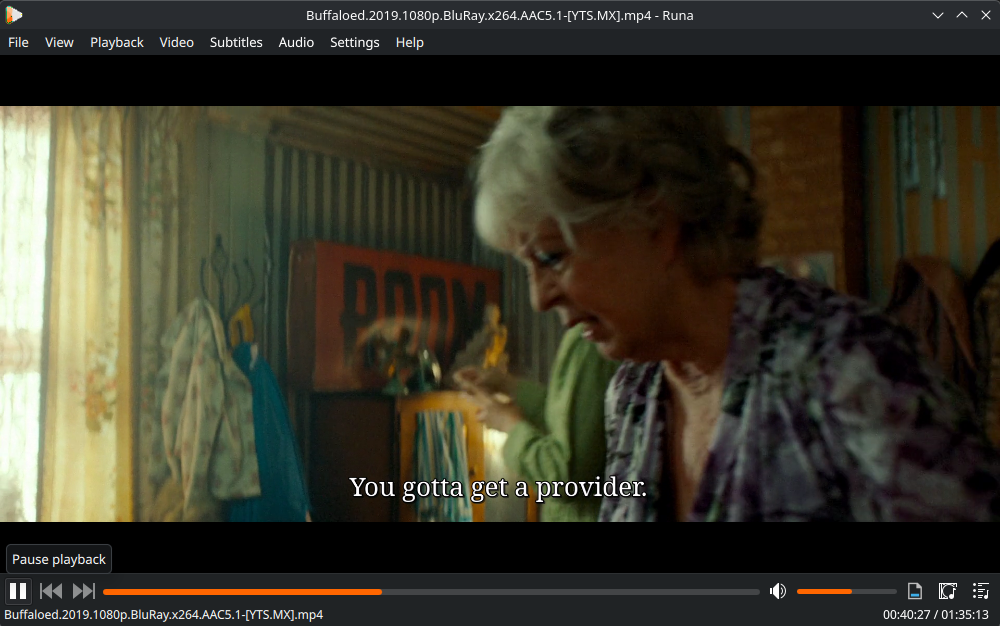
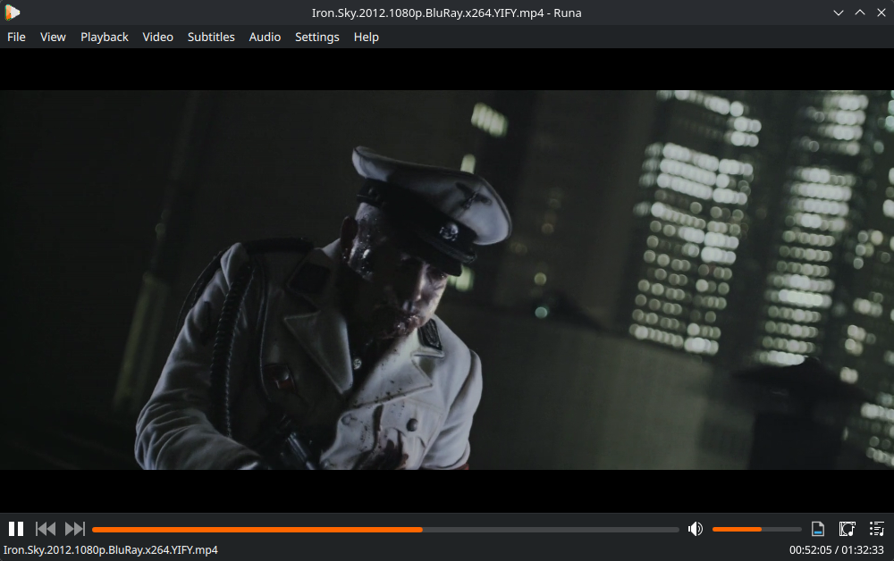
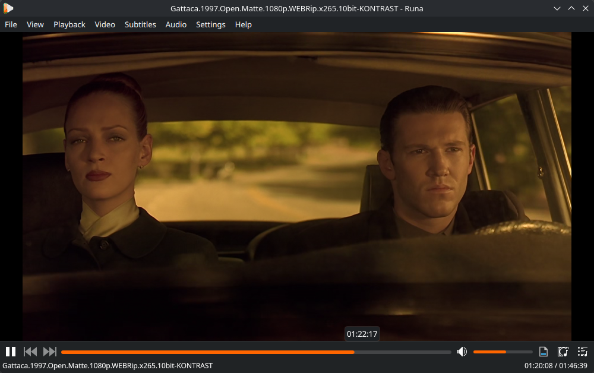

# Runa

Runa is an open source media player built with Qt 6 and QML. It plays video
and audio through libvlc, with a Kirigami interface that fits both Linux desktops
and Windows.

Runa grew out of Haruna and keeps its interface and features, but the playback
engine was replaced with libvlc.

Website: [runa.sectorfive.win](https://runa.sectorfive.win)

## Screenshots

| Buffaloed (2019) | Iron Sky (2012) | Gattaca (1997) |
| --- | --- | --- |
|  |  |  |

## Download

### Linux

Download `Runa-1.0.0-linux-x86_64.tar.gz` from the [releases page](https://github.com/Sectorfive03/Runa/releases), then:

```bash
tar -xzf Runa-1.0.0-linux-x86_64.tar.gz
cd Runa-1.0.0-linux-x86_64
./usr/bin/runa
```

The tarball contains the installed files: the binary, Qt/KDE libraries, libvlc and plugins. It runs on any reasonably recent 64-bit Linux distribution with a working OpenGL driver.

### Windows

Download `Runa-1.0.0-windows-x64.zip`, extract it anywhere and run `runa.exe`.
The archive is self-contained: Qt, KDE Frameworks, libvlc, its plugins and
yt-dlp are all included. Windows 10 or newer, 64-bit, is required.

## Build from source

### Linux

You need CMake 3.16 or newer, a C++ compiler, Qt 6.9+, KDE Frameworks 6.24+
and libvlc 3.0.16+, plus the development packages of the libraries below.

On Arch Linux:

```bash
sudo pacman -S --needed cmake ninja gcc pkgconf git \
  qt6-base qt6-declarative qt6-5compat qt6-svg qt6-shadertools qt6-tools \
  extra-cmake-modules kconfig kcoreaddons kcrash ki18n kiconthemes \
  kio kfilemetadata kcolorscheme kwindowsystem kirigami kdeclarative \
  kitemmodels qqc2-desktop-style breeze-icons kdsingleapplication \
  vlc ffmpeg yt-dlp gettext
```

Debian and Fedora package the same components under their usual names
(`qt6-base-dev`, `libkf6*-dev`, `libvlc-dev`, and so on).

Then:

```bash
git clone https://github.com/Sectorfive03/Runa.git
cd Runa
cmake -S . -B build -G Ninja -DCMAKE_BUILD_TYPE=Release
cmake --build build -j"$(nproc)"
./build/bin/runa
```

Install system-wide with `sudo cmake --install build`.

### Windows (MSYS2)

Install [MSYS2](https://www.msys2.org/), open a **UCRT64** shell and install
the toolchain and libraries:

```bash
pacman -Syu --needed git zip curl \
  mingw-w64-ucrt-x86_64-gcc mingw-w64-ucrt-x86_64-cmake \
  mingw-w64-ucrt-x86_64-ninja mingw-w64-ucrt-x86_64-pkgconf \
  mingw-w64-ucrt-x86_64-gettext-tools \
  mingw-w64-ucrt-x86_64-qt6-base mingw-w64-ucrt-x86_64-qt6-declarative \
  mingw-w64-ucrt-x86_64-qt6-5compat mingw-w64-ucrt-x86_64-qt6-svg \
  mingw-w64-ucrt-x86_64-qt6-shadertools mingw-w64-ucrt-x86_64-qt6-tools \
  mingw-w64-ucrt-x86_64-extra-cmake-modules \
  mingw-w64-ucrt-x86_64-kconfig mingw-w64-ucrt-x86_64-kcoreaddons \
  mingw-w64-ucrt-x86_64-kcrash mingw-w64-ucrt-x86_64-ki18n \
  mingw-w64-ucrt-x86_64-kiconthemes mingw-w64-ucrt-x86_64-kio \
  mingw-w64-ucrt-x86_64-kfilemetadata mingw-w64-ucrt-x86_64-kcolorscheme \
  mingw-w64-ucrt-x86_64-kwindowsystem mingw-w64-ucrt-x86_64-kirigami \
  mingw-w64-ucrt-x86_64-kdeclarative mingw-w64-ucrt-x86_64-kitemmodels \
  mingw-w64-ucrt-x86_64-qqc2-desktop-style mingw-w64-ucrt-x86_64-breeze-icons \
  mingw-w64-ucrt-x86_64-kdsingleapplication \
  mingw-w64-ucrt-x86_64-ffmpeg mingw-w64-ucrt-x86_64-vlc
```

Configure, build and bundle:

```bash
cmake -S . -B build -G Ninja -DCMAKE_BUILD_TYPE=Release
cmake --build build -j"$(nproc)"
bash packaging/windows/bundle.sh build/bin/runa.exe dist
```

`dist/` contains `runa.exe` together with everything it needs. The bundler
downloads `yt-dlp.exe` from the upstream release; set `YTDLP_EXE` to use a
local copy instead. Zip the folder to get a portable build.

## Configuration

Settings, shortcuts and the media library live in `~/.config/runaplayer/`:

- `runaplayer.conf` – general settings
- `shortcuts.conf` – keyboard and mouse shortcuts
- `runaplayer.db` – playlist and watch history

On Windows the same files are stored in the application data folder.

## License

Runa is licensed under GPL-3.0-or-later. It is based on Haruna by George
Florea Bănuș and uses Qt, KDE Frameworks, libvlc and other open source
libraries. See the source files for individual copyright notices.

Created and maintained by Sectorfive.